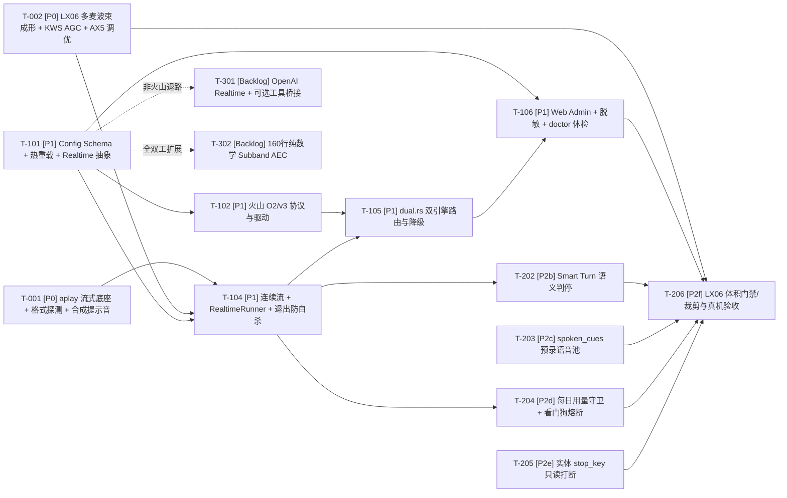

# XiaoAI Agent `dual` 模式双引擎演进执行计划与 Ticket 拆分

> 本文档为 `xiaoai-agent` 对 `rolazd/xiaoai-doubao` 全仓代码地毯式审计后制定的正式执行规划：在保留 `xiaoai-agent dual` 轻量底座与四重原生小爱互锁的前提下，**1:1 移植 `xiaoai-doubao` 全部高价值成熟模块**，并把「LX06 远场唤醒与拾音升级 (`T-002`)」前置到 **Wave 1** 与 `aplay` 流式播控底座 (`T-001`) 并行交付。
> 所有修改均须严格遵守 [AGENTS.md](../../AGENTS.md) 与 [architecture.md](../architecture.md) 中的不变量与红线约束。

---

## 一、架构基线与已锁定决策

### 1.1 核心选型与六项已锁定决策

- **基线选型结论**：在「**LX06（`/data` 13.4 MiB）+ 红米 AX5 路由器 KWS + 不需独占模式 + 日常仅需联网搜索 + 未来豆包费用较高时要能切非火山**」的约束下，坚持以 `xiaoai-agent dual` 为底座演进（零重写 48kHz/8ch 采集、UDP XPCM、四重原生互锁、Web 控制台与 `zigbuild` 工具链），不基于 `xiaoai-doubao` 做 LX06 魔改；而是将其已验证的成熟逻辑 **1:1 移植**进来。

1. **分期演进主线**：
   - **Wave 1（底座 + 唤醒止痛）**：`T-001`（`aplay` 流式播控 + 音频安全探测 + 合成提示音）+ `T-002`（LX06 多麦 Delay-and-Sum 波束成形 + KWS 专用 RMS AGC + 多声道位宽体检 + AX5 词表/解码调优）+ `T-101`（Config Schema / 热重载 / 抽象层）；
   - **Wave 2~3（P1 火山 Realtime 主线）**：`T-102`（火山 O2/v3 双鉴权 + 内置联网搜索 + 取消围栏）+ `T-104`（连续流 + 半双工 Runner + 强/弱退词分层与 `ExitEchoGuard`）→ `T-105` + `T-106`；
   - **Wave 4（P2 剩余 1:1 增强与 LX06 门禁）**：`T-202` ~ `T-206`。
2. **极简聚焦火山路线 + 预留非火山退路**：
   - 首期 P1 聚焦**火山引擎豆包端到端实时语音（O2/v3）**，并在 `StartSession` 原生开启 `enable_volc_websearch` 内置联网搜索（满足天气/新闻/日常问答）；
   - 保留统一 `RealtimeDriver` trait 抽象与现有 `cascade` 级联模式（可随时一键热切低成本非火山 ASR/LLM/TTS）；OpenAI Realtime 兼容驱动（覆盖 Qwen-Omni / OpenAI / 阶跃 / 智谱及可选工具/MCP 桥接）作为 **`T-301`** 按需扩展；
   - 官方参考规范：
     - 接入必读：<https://docs.volcengine.com/docs/doubao-voice/access-must-read?lang=en>
     - 端到端实时语音全双工版：<https://docs.volcengine.com/docs/doubao-voice/end-to-end-real-time-voice-full-duplex-version?lang=zh>
3. **默认半双工 + 预留全双工/AEC 钩子**：
   - 播报期间默认停传上行 PCM 彻底防自回声，通过「外部唤醒词 / 外部退出词 / 实体按键 / 原生“小爱同学”」四通道实现毫秒级打断，`aplay` 精确 drain 并等待 `playback_tail_ms` 后自动续聊；
   - 架构预留 `EchoCanceller` trait，供后续 **`T-302`** 1:1 移植 `xiaoai-doubao` 仅 160 行零依赖的纯数学 `subband_aec`。
4. **双引擎热切换与故障兜底**：
   - `dialogue.engine`（`cascade` | `realtime`）与 `realtime` 配置支持 `SIGHUP` 与 Web Admin 热切换（下一轮/下一次唤醒生效）；
   - Realtime 首连失败或触达每日用量上限时，可按 `realtime.fallback` 配置自动降级到现有 `cascade` 管线或通过原生 `tts_play.sh` 播报提示。
5. **共享底层、先接 `dual`**：
   - `AplayStreamPlayer`、`RealtimeDriver` / `RealtimeSessionRunner`、`SmartTurnPolicy`、`DailyUsageGuard` 封装为共享层模块；
   - **首期仅接入 `dual` 模式**，完全不动 `exclusive` 模式（`main.rs` / `session/mod.rs`）主流程，保证零回归风险。
6. **既有代码事实基线（避免重复造轮子）**：
   - `dual.rs` 已有 `is_native_xiaoai_utterance()` 作为原生小爱 ASR 句首兜底拦截；
   - `agent.rs` 已有 `conversation_log`（保留最近 150 条），Realtime 仅需通过 `record_external_turn()` 入库；
   - `start-agent.sh` 已有日志裁剪（`LOG_MAX_BYTES=2097152`），只需在其基础上补崩溃频次熔断。

### 1.2 LX06 存储与内存硬护栏（实测基线）

- **空间现状**：LX06 `/data` 分区仅 `13.4 MiB`（UBIFS 透明压缩，见 [deploy/lx06/README.md](../../deploy/lx06/README.md)）；当前 ARMv7 Release ELF 为 `7.52 MiB`（`7,890,428 B`）。由于 `flate2 1.1.9`、`miniz_oxide 0.8.9`、`tokio-tungstenite 0.29.0` 已在 `Cargo.lock` 中且音箱端不跑本地 KWS 模型，精简聚焦路线下全部 P0~P2 合入后 ELF 预计 `7.7 ~ 7.9 MiB`（UBIFS 闪存实际增量仅 `~110 ~ 200 KiB`）。
- **四条硬红线**：
  1. `spoken_cues` 目录仅放短 WAV（16 kHz / 8 kHz 单声道、`≤ 1.5 s`、整目录总计 `≤ 300 KiB`），或直接复用系统只读分区 `/usr/share/sound-vendor/XiaoMi/wakeup_*.wav` 与 `T-001` 零占用合成提示音（`0` 字节 `/data` 占用）；
  2. `daily_usage` 默认落 `/tmp/xiaoai-agent/usage`（tmpfs，零 NAND 擦写）；
  3. `AplayStreamPlayer` 排队缓冲上限 `≤ 512 KiB`，火山 O2 二进制帧 Gzip 解压上限 `≤ 1 MiB`；
  4. LX06 更新二进制必须先 `start-agent.sh stop` 再删除旧文件或经 `/tmp` 替换，禁止在 `/data` 保留 `.bak` 副本。

---

## 二、`xiaoai-doubao` 全模块 1:1 移植对照审计表

对 `rolazd/xiaoai-doubao`（`xiaoai-plus/src/`）全模块逐一审计，确保把成熟且适配 LX06 的精华全部纳入：

| `xiaoai-doubao` 原模块 | 核心功能与工程价值 | 处置方式 | 落位 Ticket / 原因 |
|---|---|---|---|
| `audio/player_aplay.cpp` | `aplay` stdin PCM 管道流式播放 + `generation` 令牌 + `waitpid` 精确 drain + `SIGPIPE` 保护 | **1:1 移植** | **`T-001`** |
| `audio/output_format.hpp` + `duplex_protocol.cpp` OggS 校验 | 下行 PCM 自动探测 `S16_LE` vs `F32`（防噪声）并硬拦截 `OggS` 头（防压缩流误当 PCM 炸喇叭） | **1:1 移植** | **`T-001`** |
| `audio/session_cue.hpp`（`MakeSessionCue` 合成部分） | 160 ms 24 kHz 柔滑上下变频提示音（带 12 ms 淡入淡出），`0` 字节闪存占用 | **1:1 移植** | **`T-001`** |
| `app/app.cpp::DownmixToMono` | ~40 行多麦互相关（`±3 sample @ 16kHz`）Delay-and-Sum 波束成形，同步拉高远场唤醒与对话信噪比 | **1:1 移植** | **`T-002`** |
| `audio/kws_preprocess.cpp::KwsAgc` | 10 ms 帧平滑 RMS AGC（目标 `-25 dBFS` / `0.0562`，增益 `1.0..=15.85`，饱和防溢出），仅送 KWS 不污染上行 | **1:1 移植** | **`T-002`** |
| `audio/kws_diagnostics.cpp`（`ObserveCaptureS32`） | 多声道 S32 真实有效位宽、`outside_signed_24`、`low_byte_zero`、峰值与削波体检 | **1:1 移植** | **`T-002`** & **`T-106`** |
| `wakeup/kws_zipformer.cpp` & `keywords_doubao_repeat_end.txt` | 干净单条主唤醒词（`#0.05`）+ `num_trailing_blanks=0` + 分离退出词（`#0.30`），不让近似变体抢 beam | **1:1 移植** | **`T-002`**（改 AX5） |
| `realtime/frame_codec.cpp` + `o2_protocol.cpp` | 火山二进制帧编解码 + Gzip 解压 + O2 事件映射 + `canceled_question_id` 取消围栏 | **1:1 移植** | **`T-102`** |
| `wakeup/exit_echo_guard.hpp` + `local_listener.cpp` + `conversation_policy.hpp::MatchedExitCommand` | `ExitEchoGuard` 防播报自杀、播报期退出词高阈值（`0.45`）、尾音保护窗、`>8` 字及否定/元语言防误退 | **1:1 移植** | **`T-104`** |
| `app/conversation_policy.hpp::LooksUnfinished/ShouldCommitTurn` | Smart Turn 中英文未说完尾词延长静音等待（`1.5s / 4.5s`） | **1:1 移植** | **`T-202`** |
| `audio/session_cue.hpp`（`MakeSpokenCue`） | 预录口语化提示音目录随机播报 + 防连续重复 + 缺失回退合成音 | **1:1 移植** | **`T-203`** |
| `realtime/daily_usage.cpp` + `boot.sh` | 本地每日 token 用量守卫 + 看门狗 30 分钟 5 次崩溃熔断 | **1:1 移植** | **`T-204`** |
| `input/stop_key.cpp` | 只读非阻塞监听 `/dev/input/event*` 实体键打断（300 ms 去抖，不抢原生触摸） | **1:1 移植** | **`T-205`** |
| `audio/subband_aec.cpp` | 仅 ~160 行纯数学 FFT 频域自适应滤波（零 WebRTC 依赖），用于真全双工消回声 | **按需移植** | **`T-302`**（Backlog） |
| `sherpa-onnx` / `onnxruntime` 本地推理 | 音箱端常驻 ~80% 单核 CPU 且模型 + 库解压超 `18 MiB` | **刻意不移植** | LX06 `/data` 仅 `13.4 MiB`，且 AX5 路由器已承担 |
| `libwebrtc_audio_processing.a` | 静态库沉重；源码证实 `NS=off` 未用于 KWS，且 OH2P 上亦未解决半双工 | **刻意不移植** | 用轻量化多麦波束成形 + KWS AGC 替代 |
| 独立 Python/SQLite 记忆后台与企微日报 | 强绑定多孩英语伴学与额外服务器运维 | **刻意不移植** | 无额外服务器前提；记忆可后续按需走轻量方案 |
| 单源 syslog `NativeWakeMonitor` | 仅监听单一日志文件，无 `max_active_s` 防死锁上限 | **刻意不移植** | `xiaoai-agent` 现有四重互锁显著更严谨 |

---

## 三、Ticket 依赖 DAG 与总览（12 个核心 Ticket + 2 个按需 Backlog）

| Ticket | 阶段 | 名称 | 前置依赖 | 预估改动量 | 波次 | 核心验收命令 |
|---|---|---|---|---|---|---|
| `T-001` | P0 | `aplay` 流式底座 + S16/F32/OggS 探测 + 合成提示音 | 无 | 中（2 新文件 + 1 修改） | Wave 1 | `cargo test audio::` |
| `T-002` | P0 | LX06 多麦波束成形 + KWS RMS AGC + S32 体检 + AX5 调优 | 无 | 中（4 修改 + AX5 打包校验） | Wave 1 | `cargo test external_kws` & AX5 C 编译 |
| `T-101` | P1 | `dialogue` & `realtime` Schema、热重载与抽象层 | 无 | 中（1 新文件 + 4 修改） | Wave 1 | `cargo test config::tests` & `cargo test reload` |
| `T-102` | P1 | 火山豆包 O2/v3 协议（双鉴权 + 内置联网搜索 + 取消围栏） | `T-101` | 中高（2 新文件） | Wave 2 | `cargo test realtime::volcengine` |
| `T-104` | P1 | 连续音频流 + `RealtimeRunner` + `ExitEchoGuard`/退出分层 | `T-001`, `T-002`, `T-101` | 高（1 新文件 + 4 修改） | Wave 2 | `cargo test realtime::runner` & `cargo test exit` |
| `T-105` | P1 | `dual.rs` 双引擎路由接入与无缝降级 | `T-102`, `T-104` | 中（1 修改） | Wave 3 | `cargo test dual::tests` |
| `T-106` | P1 | Web Admin 表单、火山多密钥脱敏与 `doctor --probe-mic` | `T-002`, `T-101`, `T-105` | 中（5 修改） | Wave 3 | `cargo test config_admin` & `cargo test server` |
| `T-202` | P2b | Smart Turn 中英文语义判停 | `T-104` | 低（1 新文件 + 1 修改） | Wave 4 | `cargo test realtime::smart_turn` |
| `T-203` | P2c | 预录口语化提示音池 (`spoken_cues` 防连续重复) | `T-001` | 低（2 修改） | Wave 4 | `cargo test earcon` |
| `T-204` | P2d | 每日用量守卫 (`daily_usage`) + 看门狗 5 次崩溃熔断 | `T-104` | 低（1 新文件 + 2 修改） | Wave 4 | `cargo test realtime::daily_usage` |
| `T-205` | P2e | 实体播放/暂停键只读打断 (`stop_key`) | `T-101` | 低中（1 新文件 + 3 修改） | Wave 4 | `cargo test stop_key` |
| `T-206` | P2f | LX06 体积门禁、可选特性裁剪评估与真机验收 | `T-106`, `T-202..T-205` | 低（配置/文档） | Wave 4 | `cargo +1.96.0 zigbuild --release --target armv7-unknown-linux-gnueabihf.2.25` |

---

## 四、Ticket 详细规格清单

### `T-001` [P0] `aplay` 流式底座 + 输出格式防护 + 合成提示音

- **目标**：建设共享的异步 `aplay` stdin PCM 流式播放器，1:1 移植 `player_aplay.cpp`、`output_format.hpp`（防 `F32`/`OggS` 误播炸喇叭）及 `session_cue.hpp` 零闪存占用合成提示音。
- **前置依赖**：无。
- **精确文件与关键符号**：
  - `[NEW] xiaoai-agent/src/audio/stream_player.rs`
    - `StreamAudioSpec`（`aplay_path`、`device`、`sample_rate`、`channels`、`playback_gain`）
    - `AplayStreamPlayer`（`start_turn`、`push_pcm`、`finish_and_drain`、`interrupt`、`is_playing`）
    - `make_session_cue_pcm(kind: CueKind, gain: f32) -> Bytes`（1:1 移植 160 ms 24 kHz 柔滑频扫 + 12 ms 淡入淡出）
  - `[NEW] xiaoai-agent/src/audio/output_format.rs`
    - `OutputFormatProbe`（1:1 移植 `S16_LE` vs `F32` 自动探测转换，并检测 `b"OggS"` 页头直接拒收错误）
  - `[MODIFY] xiaoai-agent/src/audio/mod.rs`
    - 导出 `pub mod stream_player;`、`pub mod output_format;`
    - `AudioCoordinator` 新增 `pub stream_player: Arc<AplayStreamPlayer>`
    - 在 `interrupt_for_wake()`、`stop_all_output()`、`yield_to_native_dialog()` 调用 `self.stream_player.interrupt().await`
- **实现要点与坑点**：
  - 首包 PCM 到达时再懒启动 `aplay -q -D <device> -t raw -f S16_LE -r <rate> -c <ch>`，避免空白时段占用 ALSA 句柄；LX06 `default` 经 `/etc/asound.conf` 自动走 `plug -> mysoftvol -> dmixer`；
  - `playback_gain < 1.0` 时对 `i16` 样本做饱和缩放防削波；发生 `EPIPE`/`SIGPIPE` 时清理子进程并向上返回错误；
  - `interrupt()` 必须推进 `generation`、清空排队 PCM、关闭管道并 `kill + wait` 收割子进程。
- **LX06 / 不变量护栏**：
  - 内部音频排队字节上限 **`≤ 512 KiB`**；
  - `yield_to_native_dialog()` 绝不触碰原生 `tts_play.sh` 或发送 `mphelper pause`。
- **自动化测试与反转红绿标准**：
  - Mock `aplay` 脚本验证：`start_turn` 后 `push_pcm` 写入、增益缩放、旧 `generation` 帧丢弃、`interrupt()` 终止子进程、`finish_and_drain()` 精确等待；
  - `output_format` 单测验证 `S16_LE` / `F32` 自动判定及 `OggS` 头拒收；`make_session_cue_pcm` 长度与首尾包络校验；
  - **反转校验**：临时去掉 `generation` 检查，确认过期帧泄漏写入导致单测变红后恢复。
- **独立回滚点**：删除 `audio/stream_player.rs` 与 `audio/output_format.rs` 并还原 `audio/mod.rs`。

---

### `T-002` [P0] LX06 远场拾音与唤醒全面升级（Wave 1 前置！）

- **目标**：彻底解决当前 LX06 `dual` 模式下“豆包豆包”唤醒不够灵敏的痛点，1:1 移植 `xiaoai-doubao` 的多麦 Delay-and-Sum 波束成形、`KwsAgc`、S32 多声道体检，并同步调优 AX5 端 `sherpa-onnx` 词表与解码参数。
- **前置依赖**：无。
- **精确文件与关键符号**：
  - `[MODIFY] xiaoai-agent/src/config.rs`
    - `DualCaptureConfig` 新增：
      - `mic_channels: Vec<u16>`（默认空时退回单 `mic_channel`，向后兼容；配置多麦如 `[0, 1, 2]` 时启用波束成形）
      - `kws_agc_enabled: bool`（默认 `true`——实测显著提升远场/轻声唤醒率且不污染上行 PCM）
      - `exit_playback_threshold: f32`（默认 `0.45`，配合 AX5 回包分数对播报期退出词设更高门槛）
  - `[MODIFY] xiaoai-agent/src/frontend/external_kws.rs`
    - `PcmDownsampler` 1:1 移植 `DownmixToMono`：当 `mic_channels.len() >= 2` 时，在 `16 kHz` 帧上以首麦为基准做 `±3 sample` 互相关时延对齐后求平均（同步惠及 KWS 与对话上行/ASR）；
    - `KwsAgc`（1:1 移植 `kws_preprocess.cpp`）：10 ms（160 samples）平滑 RMS AGC（目标 `-25 dBFS` / `0.0562`，增益 `1.0..=15.85`，饱和防回绕），**仅作用在发送给外部 KWS 的 UDP `XPCM_FLAG_PCM` 副本上**，发给本地 VAD / ASR / Realtime 的 `AudioChunk::pcm` 保持原始动态范围；
    - `probe_capture_channels()`（1:1 移植 `kws_diagnostics.cpp::ObserveCaptureS32`）：统计原始 8 声道 S32 的 `peak_abs`、`rms`、`outside_signed_24`、`low_byte_zero` 与当前有效通道判定，用于在 LX06 真机一次性确认 8 路中哪几路是物理麦克风、哪一路是回采以及最佳 `shift_bits`；
    - `parse_udp_reply()` 兼容解析可选第 4 段 `WAKE:<seq>:<keyword>:<score>\n`（无 `:<score>` 时兼容旧服务端，默认不拦）。
  - `[MODIFY] deploy/kws-server/ax5/src/ax5_kws_server.c`、`keywords.txt`、`start-ax5-kws.sh`
    - `ax5_kws_server.c`：开放 `--num-trailing-blanks`（默认 `0`，对齐 `xiaoai-doubao`）；透传结果 `score` 到 `WAKE:<seq>:<kw>:<score>\n`；参考 `kws_zipformer.cpp` 分离主唤醒流与会话期退出词（待机态只激活唤醒词，不让退出词在待机抢 beam 路径）；
    - `keywords.txt`：精简重复变体，主唤醒词收敛为干净的 `d òu b āo d òu b āo :1.5 #0.05 @豆包豆包`（配合适度声调容错，去掉互相抢路径的残缺截断词与待机退出词干扰）；
    - `start-ax5-kws.sh`：将默认 `KEYWORDS_THRESHOLD` / `KEYWORDS_SCORE` / `NUM_TRAILING_BLANKS` 对齐调优默认值。
- **LX06 / 不变量护栏**：
  - `KwsAgc` 绝不能作用在 `AudioChunk::pcm` 上，避免 ASR / Realtime 收到过曝底噪；
  - `parse_udp_reply` 必须完全兼容不带 `:<score>` 的旧版 `deploy/kws-server/python/` 等服务。
- **自动化测试与反转红绿标准**：
  - `PcmDownsampler` 波束成形单测：构造带 `2 sample` 相位差的模拟多路麦信号，验证对齐叠加后幅度显著优于反相/未对齐直接相加；
  - `KwsAgc` 单测：弱信号放大至目标 RMS、强信号饱和不回绕、且 `AudioChunk::pcm` 字节与关 AGC 时 100% 一致；
  - `probe_capture_channels` S32 诊断单测 + `parse_udp_reply` 带/不带分数兼容单测；
  - AX5 C 源码语法与交叉编译校验（或本地 `cc -Wall -Wextra` 编译检查）；
  - **反转校验**：将 `DownmixToMono` 的时延搜索 `kMaxLag` 临时置为 `0`，确认错位多麦合成幅度下降并使波束成形单测变红后恢复。
- **独立回滚点**：配置 `mic_channels: []`、`kws_agc_enabled: false` 即退回单麦直采；AX5 可通过保留的旧 `keywords.txt` 回退。

---

### `T-101` [P1] `dialogue` & `realtime` 配置 Schema、热重载契约与统一抽象层

- **目标**：建立 `dialogue` / `realtime` 配置模型（含火山官方双鉴权与内置联网搜索字段）、严格的热重载与回滚分类契约，以及与云厂商解耦的 `RealtimeDriver` / `EchoCanceller` trait 契约。
- **前置依赖**：无。
- **精确文件与关键符号**：
  - `[MODIFY] xiaoai-agent/Cargo.toml`：显式增加 `flate2 = "1"`（复用 `Cargo.lock` 既有 `1.1.9`）
  - `[NEW] xiaoai-agent/src/realtime/mod.rs`
    - `RealtimeEvent`、`RealtimeUsage`、`RealtimeExit`
    - `RealtimeDriver` trait（`output_sample_rate`、`input_chunk_bytes`、`send_audio`、`commit_user_turn`、`cancel_response`、`submit_tool_output`、`next_event`、`close`）
    - `EchoCanceller` trait（预留全双工 AEC 钩子）
  - `[MODIFY] xiaoai-agent/src/main.rs`：声明 `mod realtime;`
  - `[MODIFY] xiaoai-agent/src/config.rs`
    - `DialogueConfig`、`DialogueEngine`（`Cascade` [默认] | `Realtime`）
    - `RealtimeConfig`、`RealtimeProvider`（`VolcengineO2` [默认] | 预留 `OpenAiRealtime`）、`RealtimeFallback`（`Cascade` | `NativeAlert` | `None`）
    - `VolcengineO2Config`：
      - 双鉴权字段：`api_key`（`X-Api-Key`）、`app_id` + `access_key`（`X-Api-App-Id` + `X-Api-Access-Key`）、`resource_id`（默认 `"volc.speech.dialog"`）、`app_key`（默认 `"PlgvMymc7f3tQnJ6"`）；
      - 内置联网搜索字段：`enable_volc_websearch: bool`、`volc_websearch_type: String`（默认 `"web_summary"`）、`volc_websearch_api_key: String`、`volc_websearch_result_count: u8`（默认 `5`）、`volc_websearch_no_result_message: String`；
      - 会话参数：`ws_url`（默认 `"wss://openspeech.bytedance.com/api/v3/realtime/dialogue"`）、`model`（默认 `"1.2.1.1"`，支持 `"1.2.6.1"` 等）、`voice`、`bot_name`、`speaking_style`、`end_smooth_window_ms`；
    - 预留 `OpenAiRealtimeDialogueConfig`（供 `T-301` 非火山退路扩展使用）
    - `SmartTurnConfig`、`DailyUsageConfig`、预留 `DualKwsConfig::stop_key: StopKeyConfig`
  - `[MODIFY] xiaoai-agent/src/runtime/reload.rs`
    - `keep_pending_sections` 增加 `"dual.stop_key"` 回填分支
- **实现要点与坑点**：
  - 默认 `dialogue.engine = cascade`，确保现有 `agent.yaml` 100% 向后兼容；
  - `classify_config_change` 将 `dialogue`、`realtime` 划入 `applied`（热生效），将 `dual.stop_key` 划入 `needs_restart`。
- **LX06 / 不变量护栏**：
  - `DailyUsageConfig::state_dir` 默认 `/tmp/xiaoai-agent/usage`（零 NAND 擦写）；
  - 严格遵守 `AGENTS.md`：只允许热生效段触发 `AgentView` 重建；`needs_restart` 必须在 `keep_pending_sections` 回填旧值。
- **自动化测试与反转红绿标准**：
  - YAML 默认反序列化兼容性测试；热重载与回滚测试（`dialogue`/`realtime` 进 `applied`，`dual.stop_key` 进 `needs_restart` 且回填旧值）；
  - **反转校验**：注释掉 `keep_pending_sections` 中 `dual.stop_key` 分支，确认测试变红后恢复。
- **独立回滚点**：还原 `Cargo.toml`/`config.rs`/`reload.rs`/`main.rs` 并删除 `realtime/mod.rs`。

---

### `T-102` [P1] 火山引擎豆包 Realtime 二进制帧协议与 O2/v3 驱动（含双鉴权与内置联网搜索）

- **目标**：1:1 移植 `frame_codec.cpp` 与 `o2_protocol.cpp`，实现火山引擎端到端实时语音协议的二进制帧编解码器与 `VolcengineO2Driver`，完整对齐官方双鉴权规范与 `enable_volc_websearch` 联网搜索配置。
- **前置依赖**：`T-101`。
- **精确文件与关键符号**：
  - `[NEW] xiaoai-agent/src/realtime/volcengine_frame.rs`
    - `MessageType`、`Serialization`、`Compression`、`EventId`、`VolcFrame`
    - `build_json_frame`、`build_audio_frame`、`decode_frame`
  - `[NEW] xiaoai-agent/src/realtime/volcengine_o2.rs`
    - `VolcengineO2Driver`（实现 `RealtimeDriver`）
    - `build_volcengine_headers(cfg: &VolcengineO2Config, connect_id: &str)`
    - `build_start_session_payload(cfg: &VolcengineO2Config, instructions: &str)`
- **实现要点与坑点**：
  - 帧格式：4 字节协议头（`0x11` + `MessageType << 4 | Flags(0x4)` + `Serialization << 4 | Compression` + `0x00`），大端 `EventId`，连接级事件（`1/2/50/51/52`）与会话级事件（带 `session_id` / 可选 `connect_id`）；
  - **官方双鉴权握手头**：`api_key` 非空发 `X-Api-Key`；否则 `app_id` + `access_key` 非空发 `X-Api-App-Id` + `X-Api-Access-Key`；始终发 `X-Api-Resource-Id`、`X-Api-App-Key` 与 UUID `X-Api-Connect-Id`；
  - **内置联网搜索组装**：`StartSession (100)` 的 `dialog.extra` 写入 `model`、`input_mod: "keep_alive"`、`enable_volc_websearch` 及对应 `volc_websearch_*` 参数；
  - 生命周期：`StartConnection(1) -> 50 -> StartSession(100) -> 150`；上行严格 **20 ms（640 B）** 16 kHz PCM 发送 `TaskRequest(200)`；支持 `EndAsr(400)` 与 `SayHello(300)`；
  - 下行映射：`450/451/459`（ASR）、`350/550/559/352/359`（TTS 文本与 24 kHz PCM）、`154`（6 项 token 用量校验求和）、`51/153/599`（错误）；
  - **关键坑点（O2 取消围栏）**：O2 无独立 `response.cancel` 控制帧，`cancel_response()` 本地记录 `canceled_question_id` 并置 `output_allowed = false`，丢弃一切旧轮次残留音频包，直到新 ASR `question_id` 及匹配 `reply_id` 到来才重新开闸；退出会话发 `FinishSession(102)`。
- **LX06 / 不变量护栏**：
  - `Compression::Gzip` 解压硬上限 **`≤ 1 MiB`**，单帧最大包体 `≤ 1 MiB`；握手日志禁止打印服务端错误头或认证密钥回显。
- **自动化测试与反转红绿标准**：
  - 二进制帧往返编解码单测（Raw / JSON / Gzip / ErrorInfo / 有无 `connect_id` / 超过 `1 MiB` 拒绝）；
  - 双鉴权头生成单测 + `StartSession` 联网搜索 payload 组装单测；
  - O2 状态机流单测（`50→150→450→451→459→350→550→352→359→154`）+ **取消围栏测试**；
  - **反转校验**：临时放行 `canceled_question_id` 音频帧，确认取消围栏测试变红后恢复。
- **独立回滚点**：删除 `volcengine_frame.rs` 与 `volcengine_o2.rs`。

---

### `T-104` [P1] 连续音频流 + `RealtimeSessionRunner` + 退出防自杀闭环

- **目标**：在 `ExternalKwsHandle` 暴露原始连续 PCM 流，在 `AgentRuntime` 补齐轻量轮次入库，实现共享 `RealtimeSessionRunner` 多轮状态机，并 1:1 移植 `xiaoai-doubao` 的退出保护体系（`ExitEchoGuard` + 强/弱退词分层与尾音冷却 + 否定/长句防误退）。
- **前置依赖**：`T-001`、`T-002`、`T-101`。
- **精确文件与关键符号**：
  - `[MODIFY] xiaoai-agent/src/frontend/external_kws.rs`：`ExternalKwsHandle::start_realtime_stream(&mut self)`（回放 2.56s pre-wake 缓冲 + 推送 `AudioChunk`）
  - `[MODIFY] xiaoai-agent/src/agent.rs`：`AgentRuntime::record_external_turn(&self, user: &str, assistant: &str, interrupted: bool)`
  - `[MODIFY] xiaoai-agent/src/tts.rs` / `session/intent.rs`：
    - `classify_exit_command` 1:1 移植 `MatchedExitCommand`（去标点后 `> 8` 字直接排除、否定/引用/元语言白名单、尾部语气词剥离）；
    - 新增 `ExitEchoGuard`（1:1 移植 `exit_echo_guard.hpp`，追踪当前播报最近 32 字，播报中或尾音期屏蔽文本自含退出词导致的 `__CMD_EXIT__` 误触发）
  - `[NEW] xiaoai-agent/src/realtime/runner.rs`
    - `RealtimeSessionRunner`、`RealtimeRunOutcome`（`Completed` | `NativeYield` | `FallbackToCascade { initial_query: Option<String> }`）
- **实现要点与坑点**：
  - **半双工门控**：`Listening` 阶段连续送 `driver.send_audio()`（`sys_active` 时暂停）；收到首个 `AssistantAudioDelta` 经 `OutputFormatProbe` 探测转换后写入 `stream_player`，同时停传上行 PCM；收到 `AssistantAudioDone` 调用 `finish_and_drain()` 并等待 `playback_tail_ms` 后切回 `Listening`；
  - **退出分层守卫**：播报期/尾音期收到 `BargeInSignal::ExitCmd` 时，同时校验 `score >= exit_playback_threshold` 与 `!exit_echo_guard.contains(keyword)`；
  - **四通道毫秒级打断**（`tokio::select!`）：原生小爱（`yield_to_native_dialog`）、唤醒词（`cancel_response`）、退出词、预留 `stop_key`；
  - **本地意图与原生兜底**：`UserTranscriptCompleted` 先查 `is_native_xiaoai_utterance()`，再查音量控制与退出指令；完整轮次写入 `agent.record_external_turn()`。
- **LX06 / 不变量护栏**：
  - `ExternalKwsHandle` 仅发送未经 `KwsAgc` 改动的原始波束成形 PCM；异常退出必须保证 `kws.stop_stream()` 与 `stream_player.interrupt()` 执行。
- **自动化测试与反转红绿标准**：
  - 使用内存 `MockRealtimeDriver` 测试：半双工不漏上行、`Wake` 打断停止播放并调 `cancel_response`、`UserTranscriptCompleted("小爱同学...")` 返回 `NativeYield`、首连失败返回 `FallbackToCascade`；
  - `ExitEchoGuard` 与 `classify_exit_command` 单测（播报含“再见”拦截 `__CMD_EXIT__`、“不想关闭”“怎么说再见”不退出）；
  - **反转校验**：在 `Speaking` 期去掉上行门控或去掉 `ExitEchoGuard` 检查，确认测试变红后恢复。
- **独立回滚点**：删除 `realtime/runner.rs` 并还原 `external_kws.rs` / `agent.rs` / `tts.rs` 新增接口。

---

### `T-105` [P1] `dual.rs` 双引擎路由接入与无缝降级

- **目标**：在 `dual.rs` 接入 `RealtimeSessionRunner` 与 `VolcengineO2Driver`，实现唤醒后按 `dialogue.engine` 分流与失败降级 `cascade`，且严格保持 `exclusive` 模式零改动。
- **前置依赖**：`T-102`、`T-104`。
- **精确文件与关键符号**：
  - `[MODIFY] xiaoai-agent/src/dual.rs`：`run_dual_daemon()` 增加 `DialogueEngine::Realtime` 分支与 `FallbackToCascade` 转入现有级联流程逻辑
- **实现要点与坑点**：
  - `Cascade` 原样走现有逻辑；`Realtime` 驱动 `VolcengineO2Driver`，返回 `FallbackToCascade` 时直接落入级联分支；外层 `tokio::select!` 原生小爱互锁覆盖 Realtime 全阶段，让位时调用 `yield_to_native_dialog(true)` 并跳过 `release_dialog_focus()`。
- **LX06 / 不变量护栏**：使用 `native_alert` 提示时检查 `!native_monitor.is_blocked()`。
- **自动化测试与反转红绿标准**：路由与降级单测 + 全量 `cargo test`；`exclusive` 相关测试零修改全绿。
- **独立回滚点**：还原 `dual.rs` 分流代码块即可瞬间退回纯 `cascade`。

---

### `T-106` [P1] Web Admin Console 表单、火山多密钥脱敏与 `doctor --probe-mic` 诊断

- **目标**：支持 Web 控制台安全切换 `cascade` / `realtime`、配置火山双鉴权与联网搜索密钥，并提供 `doctor --probe-mic` 3 秒多声道位宽实测工具。
- **前置依赖**：`T-002`、`T-101`、`T-105`。
- **精确文件与关键符号**：
  - `[MODIFY] xiaoai-agent/src/runtime/config_admin.rs`：`SECRET_PATHS` 增加 `&["realtime", "volcengine_o2", "api_key"]`、`&["realtime", "volcengine_o2", "access_key"]`、`&["realtime", "volcengine_o2", "volc_websearch_api_key"]`、`&["realtime", "openai_realtime", "api_key"]`
  - `[MODIFY] xiaoai-agent/src/config.rs`：`collect_startup_warnings` 校验火山双鉴权完整度、联网搜索参数与 WS URL
  - `[MODIFY] xiaoai-agent/src/runtime/doctor.rs` & `main.rs`：增加 `dialogue.engine`、`realtime.provider`、WS 连通探针、`/data` `< 2 MiB` 告警，以及 `xiaoai-agent doctor --probe-mic` 调用 `probe_capture_channels()` 打印 LX06 8 声道实测指标
  - `[MODIFY] xiaoai-agent/src/server.rs` & `panel.html`：引擎状态与双协议配置表单（严守路由级 `require_token` + `POST`）
- **自动化测试与反转红绿标准**：
  - `config_admin` 单测验证所有新增 `realtime.*` 密钥脱敏与 `__REDACTED__` 回填还原；`server.rs` 路由鉴权测试全绿；
  - **反转校验**：从 `SECRET_PATHS` 临时移除 `volc_websearch_api_key`，确认脱敏测试变红后恢复。
- **独立回滚点**：还原上述 5 个文件新增字段与 UI 区块。

---

### `T-202` [P2b] Smart Turn 中英文语义判停

- **目标**：1:1 移植 `conversation_policy.hpp::LooksUnfinished/ShouldCommitTurn`，在 Realtime 模式根据实时转写尾词动态延长等待（未说完 `4.5s`，说完 `1.5s`）。
- **前置依赖**：`T-104`。
- **精确文件与关键符号**：
  - `[NEW] xiaoai-agent/src/realtime/smart_turn.rs`：`looks_unfinished(text: &str) -> bool`、`should_commit_turn(text: &str, quiet_ms: u64, complete_ms: u64, open_ms: u64) -> bool`
  - `[MODIFY] xiaoai-agent/src/realtime/runner.rs`：开启 `smart_turn.enabled` 时驱动 `driver.commit_user_turn()`
- **自动化测试与反转红绿标准**：覆盖 `"I want"`, `"because"`, `"我想"`, `"然后"` 与完整句对比测试。
- **独立回滚点**：配置 `realtime.smart_turn.enabled: false`。

---

### `T-203` [P2c] 预录口语化提示音池 (`spoken_cues`)

- **目标**：1:1 移植 `MakeSpokenCue` 防重复随机语音池，支持 `enter_earcon` / `exit_earcon` / `thinking_earcon` 指向目录（目录缺失/为空时自动回退 `T-001` 零占用合成提示音）。
- **前置依赖**：`T-001`。
- **精确文件与关键符号**：
  - `[MODIFY] xiaoai-agent/src/audio/mod.rs`：`EarconPicker`（目录扫描非空 `.wav`、记忆上次选择防连续重复）
  - `[MODIFY] xiaoai-agent/src/config.rs`：`collect_startup_warnings` 若目录总大小 `> 300 KiB` 发出 LX06 空间告警
- **自动化测试与反转红绿标准**：单测验证跳过 `0 B` 文件、非连续重复选取、目录缺失回退合成音。
- **独立回滚点**：保持配置文件为单文件或 `null`。

---

### `T-204` [P2d] 每日用量守卫 (`daily_usage`) + `start-agent.sh` 崩溃熔断

- **目标**：1:1 移植 `daily_usage.cpp` 本地每日用量守卫与 `boot.sh` 30 分钟 5 次崩溃熔断，防费用失控与异常重启死循环。
- **前置依赖**：`T-104`。
- **精确文件与关键符号**：
  - `[NEW] xiaoai-agent/src/realtime/daily_usage.rs`：`DailyUsageGuard`（默认目录 `/tmp/xiaoai-agent/usage`，零闪存擦写）
  - `[MODIFY] xiaoai-agent/src/realtime/runner.rs`：会话前检查限额，收到 `ResponseDone { usage }` 累加
  - `[MODIFY] xiaoai-agent/start-agent.sh`：`start_dual_watchdog` 增加 30 分钟 5 次异常重启熔断（持续运行满 5 分钟清零），**严禁触碰 `exclusive` 模式退出码 `0/3/4/5` 契约**
- **自动化测试与反转红绿标准**：跨日重置、超限拦截、JSON 损坏容错单测 + `sh -n start-agent.sh` 与熔断模拟验证。
- **独立回滚点**：`daily_token_limit: 0` 禁用拦截；还原 `start_dual_watchdog`。

---

### `T-205` [P2e] 实体播放/暂停键只读打断 (`stop_key`)

- **目标**：1:1 移植 `stop_key.cpp`，只读非阻塞监听 `/dev/input/event*` 指定 `key_code`（默认禁用，绝不独占 grab），播报中一拍即停。
- **前置依赖**：`T-101`。
- **精确文件与关键符号**：
  - `[NEW] xiaoai-agent/src/frontend/stop_key.rs`：`StopKeyListener`（Linux 非阻塞读取 + 300 ms 去抖；非 Linux 空实现）
  - `[MODIFY] xiaoai-agent/src/dual.rs`、`config.rs`、`runtime/reload.rs`：仅活跃会话响应打断，待机不影响原生触摸
- **自动化测试与反转红绿标准**：虚拟 `input_event` 字节流测试连按忽略与 300 ms 去抖；跨平台 `cargo test` 通过。
- **独立回滚点**：保持默认 `device: ""`, `key_code: -1`。

---

### `T-206` [P2f] LX06 体积门禁、可选特性裁剪评估与真机验收手册

- **目标**：验证全量改造后 ARMv7 glibc 2.25 二进制满足 LX06 `13.4 MiB` `/data` 硬约束，评估纯 `dual` 裁剪选项，输出完整真机验收手册。
- **前置依赖**：`T-106`、`T-202`~`T-205`。
- **精确文件**：
  - `[MODIFY] xiaoai-agent/Cargo.toml`（评估统一 `tokio-tungstenite` 版本消除 0.28/0.29 双版本；评估可选 `exclusive` / `airplay` / `music` Cargo feature 裁剪开关）
  - `[MODIFY] docs/architecture.md` & `deploy/lx06/README.md`（补充双引擎架构、LX06 无 `.bak` 安全更新流程与真机验收清单）
- **体积门禁与真机验收标准**：
  - 交叉编译：`cargo +1.96.0 zigbuild --release --target armv7-unknown-linux-gnueabihf.2.25`
  - 体积硬门槛：Release ELF **`≤ 8.5 MiB`**（`8,912,896 B`），LX06 UBIFS 占用 `≤ 4.8 MiB`；
  - 真机验收清单：P0（`aplay` 24kHz 直播与 `<100ms` 打断 + 多麦波束/AGC 远场唤醒率对比）、P1（火山双鉴权 + `enable_volc_websearch` 联网对话 5 轮 + 四通道打断无双播无熄灯 + `cascade` 降级与热切换）、P2（Smart Turn、`spoken_cues`、熔断与用量守卫、`stop_key`）。

---

## 五、P3 / 按需扩展 Backlog（本期不实施）

| 项目 | 说明 | 前置条件 |
|---|---|---|
| **`T-301` [按需非火山退路] OpenAI Realtime 兼容驱动 + 可选工具/MCP 桥接** | 若后期火山费用偏高需切换 Qwen-Omni Realtime / OpenAI Realtime / 阶跃 / 智谱，基于 `T-101` 的 `RealtimeDriver` 与 `T-104` 的 `RealtimeSessionRunner` 直接新增 `realtime/openai.rs` 零破坏接入；按需补充工具/MCP 桥接 | `T-101`, `T-104` 稳定 |
| **`T-302` [1:1 移植全双工] 160 行纯数学 `subband_aec`** | 1:1 移植 `xiaoai-doubao` 仅 160 行零 WebRTC 依赖的频域自适应滤波器（实现 `T-101` 预留的 `EchoCanceller` trait），结合 `ref_channel` 为 LX06/OH2P 实现免唤醒词真全双工插话 | `T-104` 稳定 + 真机延迟标定 |
| **Web Admin Persona 预设** | 在 Web 控制台提供儿童英语伴学 / 故事大王 / 通用助手等系统提示词预设一键热加载（对话记录复用已有 `conversation_log`） | `T-106` 稳定 |
| **轻量跨会话长期记忆** | 优先通过已有 MCP 体系对接记忆服务；或支持本地 `/data/open-xiaoai/memory.md`（硬上限 `≤ 4 KiB`）注入系统提示词 | `T-105` 稳定 |

---

## 六、推荐推进节奏

1. **Wave 1（底座与唤醒止痛并行）**：`T-001` + `T-002` + `T-101` → 优先解决当前 `dual` 唤醒不够灵敏的问题，同时夯实 `aplay` 直播与配置抽象底座。
2. **Wave 2（火山协议与半双工内核并行）**：`T-102` + `T-104` → 跑通火山 O2/v3 协议、内置联网搜索与退出防自杀全量单测。
3. **Wave 3（P1 合龙与首次真机闭环）**：`T-105` + `T-106` → 完成 P0+P1 闭环，上 LX06 实测火山豆包实时语音 + 内置联网搜索 + `cascade` 兜底。
4. **Wave 4（P2 增强与收口）**：`T-202` ~ `T-205` 并行实施 → `T-206` 做 LX06 体积门禁、可选裁剪评估与全量真机验收。
